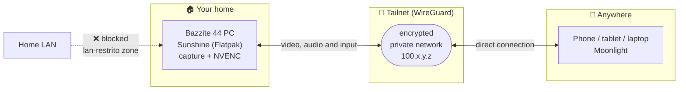

<div align="center">

# 🎮 Play your home PC from anywhere

**Stream games from your Linux PC to a phone, tablet or laptop — without opening a single port on your router.**

[](https://bazzite.gg)
[](https://docs.lizardbyte.dev/projects/sunshine/)
[](https://tailscale.com)
[](https://moonlight-stream.org)

[Português](README.md) · **English**

[Full guide (HTML, pt-BR)](guias/bazzite-host-tailscale-sunshine.html) ·
[Video tutorial (pt-BR)](video/render/) ·
[Windows host](planos/configurar-tailscale-sunshine-moonlight.md)

</div>

> [!NOTE]
> The guide, the scripts' output and the video are in Brazilian Portuguese. Every command is
> language-neutral, and this page carries the complete procedure in English.

---

## 🤖 Let an AI agent set it up for you

This repository ships an [`AGENTS.md`](AGENTS.md) — read automatically by **Claude Code**,
**Codex**, **Cursor** and other agents. It holds the executable procedure, with a verification
step after each change and the safety rules baked in.

```bash
git clone https://github.com/edilsonvilarinho/configurar-tailscale-sunshine-moonlight.git
cd configurar-tailscale-sunshine-moonlight
claude          # or: codex, cursor-agent, opencode...
```

Then ask, in these words or close to them:

```text
Read AGENTS.md and configure this host following the procedure,
verifying each step before moving to the next.
```

<details>
<summary><b>What the agent does — and what it won't do without you</b></summary>

**On its own:** machine inventory, Sunshine install, `sunshine.conf` changes (with a backup),
display selection, port and service verification, and the closing report.

**Needs you:** the `sudo` password (it cannot type one — it either hands you the command or opens
a terminal in your session), the Tailscale login approval in the browser, creating the Sunshine
password, and the Moonlight PIN.

**Never without your explicit confirmation:** enabling autologin, masking system suspend, and
restricting the LAN firewall.

**Never at all:** opening a router port, disabling the firewall, enabling UPnP, or writing a
password, token or PIN into a file, log or commit.
</details>

> [!TIP]
> Rather do it by hand? The full walkthrough is right below — `AGENTS.md` is the same procedure,
> written to be executed by a machine.

---

## What this is

A tested, end-to-end guide that turns a **Bazzite 44** PC into a remote gaming host. The PC stays
home; you play from anywhere, over the Tailscale private network.

**Nothing is exposed to the internet:** no port forwarding, no UPnP, no public IP. The service is
reachable only from devices authenticated on your tailnet.

### Measured result

Real numbers from the install this guide came out of, not estimates:

| | |
|---|---|
| Video | **HEVC** via **NVENC** (RTX 4070 SUPER), 3440×1440 |
| Bitrate | 15 Mbps, 60 fps pacing |
| Audio | Opus 48 kHz, 2 channels |
| Connection | **direct** between client and host (no DERP relay) |
| Ports open to the internet | **none** |

---

## How it works



| Piece | Runs on | Job |
|---|---|---|
| **Sunshine** | the PC with the games | captures the screen, encodes on the GPU, streams |
| **Moonlight** | the receiving device | decodes and sends keyboard, mouse and gamepad back |
| **Tailscale** | both | WireGuard private network linking the two directly |

---

## Before you start

- A PC running **Bazzite** (tested on 44 Kinoite, `bazzite-nvidia-open` image)
- A **Wayland + KDE** session (the Kinoite default)
- A free [Tailscale](https://tailscale.com) account
- A device to receive the stream: phone, tablet or another computer

> [!NOTE]
> In the commands below, `100.x.y.z` is the address **your** host will get on the tailnet. Find
> yours with `tailscale ip -4` and use that value.

---

## Quick start

For those who know the terrain. The detailed walkthrough follows.

```bash
# 1. inspect the machine (changes nothing)
bash scripts/bazzite-host-preflight.sh

# 2. Tailscale (already shipped in the Bazzite image)
ujust tailscale enable
sudo tailscale up --operator=$USER
tailscale ip -4

# 3. Sunshine
ujust setup-sunshine          # pick: Enable (Flatpak)

# 4. let the web UI through over the tailnet
CONF=~/.var/app/dev.lizardbyte.app.Sunshine/config/sunshine/sunshine.conf
cp -a "$CONF" "$CONF.backup-$(date +%Y%m%d-%H%M%S)"
printf 'origin_web_ui_allowed = wan\nupnp = disabled\n' >> "$CONF"
printf 'csrf_allowed_origins = https://%s:47990\n' "$(tailscale ip -4)" >> "$CONF"
systemctl --user restart app-dev.lizardbyte.app.Sunshine

# 5. close the ports to the local network (why, in step 6)
bash scripts/bazzite-host-firewall-tailnet.sh --apply
```

---

## Walkthrough

### Step 0 · Look before you touch

None of this changes the system. Keep the output: it is what you compare against if something
breaks later.

```bash
bash scripts/bazzite-host-preflight.sh
```

<details>
<summary>What the script checks</summary>

```bash
grep -E '^(PRETTY_NAME|VARIANT_ID)=' /etc/os-release   # Bazzite version and variant
echo $XDG_SESSION_TYPE $XDG_CURRENT_DESKTOP            # expected: wayland KDE
nvidia-smi --query-gpu=name,driver_version --format=csv,noheader
systemctl is-enabled tailscaled                        # Tailscale state
flatpak info dev.lizardbyte.app.Sunshine               # Sunshine already installed?
firewall-cmd --get-default-zone                        # firewalld default zone
firewall-cmd --get-active-zones
```
</details>

---

### Step 1 · Turn Tailscale on

The binary **already ships with Bazzite** — it is just disabled.

```bash
ujust tailscale enable
# same as: sudo systemctl enable --now tailscaled.service
# via GUI: Bazzite Portal → Manage Bazzite → Enable Tailscale

sudo tailscale up --operator=$USER
```

It prints a `https://login.tailscale.com/a/…` link. Open it and approve the machine **on the same
account** the client device will use.

```bash
tailscale status      # confirms the tailnet
tailscale ip -4       # WRITE THIS DOWN: the client reaches you at this address
tailscale netcheck    # route diagnostics, if needed
```

> [!TIP]
> `--operator=$USER` lets you run `tailscale status` and `tailscale ip` later without `sudo`.

---

### Step 2 · Install Sunshine

```bash
ujust setup-sunshine        # pick: Enable (Flatpak)
```

<details>
<summary>What the recipe runs underneath</summary>

```bash
flatpak install --system -y dev.lizardbyte.app.Sunshine
flatpak run --command=additional-install.sh dev.lizardbyte.app.Sunshine   # asks for your password
systemctl --user enable --now app-dev.lizardbyte.app.Sunshine
```

`additional-install.sh` installs the `uinput` permissions. **Without it you get video, but no
remote keyboard, mouse or gamepad.**
</details>

Confirm it came up:

```bash
systemctl --user status app-dev.lizardbyte.app.Sunshine --no-pager
ss -ltn | grep -E ':(47984|47989|47990|48010) '
```

> [!IMPORTANT]
> The Flatpak does **not** support KMS capture, which Game Mode (gamescope) on Deck images needs.
> On a Kinoite desktop the Flatpak is the right path; for Game Mode see
> `ujust setup-sunshine enable-brew`.

---

### Step 3 · Capture permission (Wayland/KDE)

This step does not exist on Windows and is where most people get stuck.

1. On the first capture KDE asks for permission — **accept and tick "remember"**.
2. In *System Settings → Applications → Application Permissions*, enable **Remote control** for Sunshine.
3. In the Sunshine UI, use **KWin Screencast** capture.

**Error 503 / "Failed to find display":**

```bash
mkdir -p ~/.config/environment.d
echo 'KWIN_WAYLAND_NO_PERMISSION_CHECKS=1' > ~/.config/environment.d/98-kwin-no-permission-checks.conf
# log out and back in — the variable only applies to a new session
```

> [!WARNING]
> **X11 and NvFBC do not work on Bazzite.** Don't spend time on them.

---

### Step 4 · Create the Sunshine password

Do the first login **locally**:

```bash
xdg-open https://localhost:47990      # or: ujust setup-sunshine portal
```

The certificate warning is expected (self-signed). Create the user and a **strong password** —
this password guards full control of your computer; don't reuse your system password.

<details>
<summary>Resetting the password from the command line</summary>

```bash
systemctl --user stop app-dev.lizardbyte.app.Sunshine
flatpak run --command=sunshine dev.lizardbyte.app.Sunshine --creds admin 'YOUR-STRONG-PASSWORD'
systemctl --user start app-dev.lizardbyte.app.Sunshine
```
</details>

---

### Step 5 · Let the web UI through over the tailnet

Two Sunshine gotchas, both in the same file:

- **`origin_web_ui_allowed`** — the `lan` default accepts private ranges only. The tailnet uses
  `100.64.0.0/10` (CGNAT), which does **not** count as LAN. You need `wan`.
- **`csrf_allowed_origins`** — without the exact origin, submitting the PIN fails with
  `CSRF Protection Error`.

```bash
CONF=~/.var/app/dev.lizardbyte.app.Sunshine/config/sunshine/sunshine.conf
cp -a "$CONF" "$CONF.backup-$(date +%Y%m%d-%H%M%S)"

HOST_IP=$(tailscale ip -4)
printf 'origin_web_ui_allowed = wan\nupnp = disabled\n' >> "$CONF"
printf 'csrf_allowed_origins = https://%s:47990\n' "$HOST_IP" >> "$CONF"

systemctl --user restart app-dev.lizardbyte.app.Sunshine
grep -E 'origin_web_ui_allowed|csrf_allowed_origins|upnp' "$CONF"
```

> [!NOTE]
> `wan` publishes **nothing** to the internet: it only turns off the IP-range filter. What limits
> reach is the firewall (step 6) plus the absence of port forwarding. `upnp = disabled` stops the
> router from opening ports on its own.

---

### Step 6 · Firewall — and the Linux surprise

Here Linux **inverts** what Windows taught you. Bazzite's default zone (`FedoraWorkstation`) contains:

```xml
<port protocol="tcp" port="1025-65535"/>
<port protocol="udp" port="1025-65535"/>
```

Every Sunshine port is **already open, on every interface** — including your home network. Nothing
needs opening: things need **closing**.

| | Windows | Bazzite |
|---|---|---|
| Default behaviour | blocks | allows the whole high range |
| Your job | open the right ports | close what shouldn't be open |
| Failure symptom | won't connect at all | connects too well, LAN included |

```bash
bash scripts/bazzite-host-firewall-tailnet.sh            # dry run (default)
bash scripts/bazzite-host-firewall-tailnet.sh --apply    # apply
bash scripts/bazzite-host-firewall-tailnet.sh --revert   # undo
```

<details>
<summary>By hand, and why it works</summary>

The tailnet interface stays in the permissive default zone; the home NIC moves to a new one:

```bash
ZONE=lan-restrito
sudo firewall-cmd --permanent --new-zone="$ZONE"
sudo firewall-cmd --permanent --zone="$ZONE" --add-service=dhcpv6-client
sudo firewall-cmd --permanent --zone="$ZONE" --add-service=mdns
sudo firewall-cmd --reload

# pin the zone to the connection so it survives a reboot
sudo nmcli connection modify "Wired connection 1" connection.zone "$ZONE"
sudo nmcli connection up "Wired connection 1"

firewall-cmd --get-active-zones
firewall-cmd --get-zone-of-interface=tailscale0    # expected: no zone
```

Checking from outside:

```bash
nc -vz <lan-ip>       47990    # must FAIL
nc -vz <100.x.y.z>    47990    # must CONNECT
```

The restricted zone blocks inbound LAN traffic on high ports: KDE Connect, local Steam Remote Play
and file sharing stop working. Open the specific port instead of dropping the restriction — the
script accepts `EXTRA_PORTS="1714-1764/tcp 1714-1764/udp"`.
</details>

> [!CAUTION]
> **Do not change the firewall zone of the `tailscale0` interface.** A known bug
> ([tailscale#15968](https://github.com/tailscale/tailscale/issues/15968), versions ≥ 1.84) brings
> the link down. The strategy above never touches it.

---

### Step 7 · Pick the right monitor

With more than one display the failure is **silent**: without configuration Sunshine captures the
first available stream, which may not be your main screen. Nothing errors out — the client just
gets the wrong screen.

```bash
# find the name in Sunshine's own log
grep '\[wayland\] Name' ~/.var/app/dev.lizardbyte.app.Sunshine/config/sunshine/sunshine.log | tail -4

echo 'output_name = DP-1' >> "$CONF"
systemctl --user restart app-dev.lizardbyte.app.Sunshine

grep 'Streaming display' ~/.var/app/dev.lizardbyte.app.Sunshine/config/sunshine/sunshine.log | tail -1
# expected: [pipewire] Streaming display 'DP-1' resolution: 3440x1440
```

<details>
<summary>No physical monitor (virtual display)</summary>

```bash
ujust setup-sunshine virtual-monitor     # → Add Virtual Monitor
```
KWin only (Kinoite), and it requires **KWin Screencast** capture.
</details>

---

### Step 8 · A host that's ready with nobody in front of it

On Bazzite, Sunshine is a **user service** and capture depends on an open graphical session. If
the PC reboots and nobody logs in, there is no screen to capture.

```bash
# 1. KDE autologin
sudo mkdir -p /etc/sddm.conf.d
sudo tee /etc/sddm.conf.d/10-autologin.conf >/dev/null <<'EOF'
[Autologin]
User=YOUR-USERNAME
Session=plasma.desktop
Relogin=false
EOF

# 2. never suspend (otherwise you lose remote access)
sudo systemctl mask sleep.target suspend.target hibernate.target hybrid-sleep.target

# 3. keep the user service alive across sessions
loginctl enable-linger $USER
```

> [!WARNING]
> Autologin is a deliberate trade: anyone with **physical** access walks into your desktop without
> a password. To undo: `sudo rm /etc/sddm.conf.d/10-autologin.conf` and
> `sudo systemctl unmask sleep.target suspend.target hibernate.target hybrid-sleep.target`.

---

### Step 9 · The client device

1. Install **Tailscale** and sign in to the **same account** as the PC.
2. Install **Moonlight**:
   - Android / iOS: the device's app store
   - Linux: `flatpak install flathub com.moonlight_stream.Moonlight`
   - Windows: `winget install MoonlightGameStreamingProject.Moonlight`
3. In Moonlight: **Add PC** → enter the host's `100.x.y.z` address.
4. Moonlight shows a **4-digit PIN**.

Submit the PIN through the web UI (`https://100.x.y.z:47990`, **PIN** tab) or, more directly,
through the host's own API:

```bash
curl -sk -u admin:'YOUR-PASSWORD' -X POST https://localhost:47990/api/pin \
  -d '{"pin":"1234","name":"phone"}'
# expected: {"status":"true"}
```

> [!TIP]
> The API shortcut sidesteps the CSRF error entirely, because no browser is involved.

---

## Ports in use

None of them needs to be opened on the router. The table is for diagnostics.

| Port | Protocol | Purpose |
|---|---|---|
| 47984 | TCP | service HTTPS |
| 47989 | TCP | service HTTP (base port) |
| 47990 | TCP | web UI |
| 48010 | TCP | RTSP |
| 47998 / 47999 / 48000 | UDP | video / control / audio |
| 48002 | UDP | microphone (optional) |

---

## Final validation

```bash
tailscale status                                            # right tailnet, 100.x.y.z address
systemctl --user is-active app-dev.lizardbyte.app.Sunshine  # active
ss -ltn | grep -E ':(47984|47989|47990|48010) '             # four ports listening
curl -sk -o /dev/null -w '%{http_code}\n' https://$(tailscale ip -4):47990/   # 401 = good
curl -sk -u admin:PASSWORD https://localhost:47990/api/apps | jq -r '.apps[].name'
```

- [ ] From the LAN (off the tailnet), port 47990 does **not** connect
- [ ] Moonlight lists the apps and starts a session
- [ ] Video, audio, keyboard, mouse and gamepad all work
- [ ] After a reboot everything comes back on its own

---

## Troubleshooting

| Symptom | Likely cause | Fix |
|---|---|---|
| Web UI won't open even on `localhost` | service down, or no graphical session | `journalctl --user -u app-dev.lizardbyte.app.Sunshine -b` |
| Opens locally, not over the tailnet | `origin_web_ui_allowed = lan` | step 5 |
| `CSRF Protection Error` on the PIN | origin not allowed | `csrf_allowed_origins` with the exact address |
| Error 503 / "Failed to find display" | KWin refused the capture | `KWIN_WAYLAND_NO_PERMISSION_CHECKS=1` + re-login |
| Video works, mouse and keyboard don't | `additional-install.sh` never ran | `flatpak run --command=additional-install.sh dev.lizardbyte.app.Sunshine` |
| Wrong screen arrives | `output_name` not set | step 7 |
| `tailscale ping` fails | routing/tailnet, not the firewall | `tailscale netcheck` on both ends |
| Ping fine, port closed | firewall or service down | `firewall-cmd --list-all --zone=lan-restrito` |
| `Failed to gain CAP_SYS_ADMIN` in the log | **noise** — KMS capture probe in the Flatpak | ignore it; the log itself says so |

<details>
<summary>Collecting evidence</summary>

```bash
journalctl --user -u app-dev.lizardbyte.app.Sunshine -b --no-pager | tail -200
sudo nft list ruleset | head -80
firewall-cmd --list-all-zones
tailscale status --json | head -40
sudo tcpdump -ni tailscale0 'port 47990 or port 48010' -c 20
```

Never paste a password, token or PIN into a log, issue or pull request.
</details>

---

## Repository layout

```
.
├── AGENTS.md                                  executable procedure for AI agents
├── guias/
│   └── bazzite-host-tailscale-sunshine.html   full visual guide (pt-BR)
├── scripts/
│   ├── bazzite-host-preflight.sh              pre-flight check (read-only)
│   └── bazzite-host-firewall-tailnet.sh       restricts Sunshine to the tailnet
├── planos/
│   ├── configurar-bazzite-sunshine-tailscale-moonlight.md   decisions and run log (Linux)
│   ├── configurar-tailscale-sunshine-moonlight.md           Windows host
│   ├── guia-maquina-cliente-tailscale-moonlight.md          Windows client
│   └── *.ps1                                                Windows host scripts
└── video/
    ├── roteiro.py           video script (single source of truth)
    ├── gerar_video.py       renderer: PIL + Piper + ffmpeg
    ├── gerar_miniatura.py   YouTube thumbnail
    ├── publicacao.md        per-platform titles, descriptions and hashtags
    └── render/              finished videos (6 formats) + subtitles + thumbnail
```

---

## Video tutorial

Generated from code — the script is a data file, narration is synthesized, screens are drawn.
Fixing a command means editing the script and re-rendering. Details in
[`video/README.md`](video/README.md). Narration is in Brazilian Portuguese; `.srt` subtitles ship
with every cut.

| Cut | Format | Length | File |
|---|---|---|---|
| YouTube (full) | 1920×1080 | 8m21 | [`youtube-longo.mp4`](video/render/youtube-longo.mp4) |
| YouTube Shorts | 1080×1920 | 1m00 | [`youtube-shorts.mp4`](video/render/youtube-shorts.mp4) |
| TikTok | 1080×1920 | 1m01 | [`tiktok.mp4`](video/render/tiktok.mp4) |
| Instagram Reels | 1080×1920 | 1m03 | [`instagram-reels.mp4`](video/render/instagram-reels.mp4) |
| Instagram feed | 1080×1350 | 1m03 | [`instagram-feed.mp4`](video/render/instagram-feed.mp4) |
| LinkedIn | 1080×1080 | 1m38 | [`linkedin.mp4`](video/render/linkedin.mp4) |

---

## Windows host

The equivalent Windows setup, with its run log and PowerShell scripts, lives in
[`planos/configurar-tailscale-sunshine-moonlight.md`](planos/configurar-tailscale-sunshine-moonlight.md)
(pt-BR). The Windows client has its own guide in
[`planos/guia-maquina-cliente-tailscale-moonlight.md`](planos/guia-maquina-cliente-tailscale-moonlight.md).

The core difference between the two systems is the firewall: on Windows the `Private` profile with
`AllowInboundRules=False` swallowed Sunshine's rules; on Bazzite the default zone allows too much.

---

## Security

- No router port is opened, and `upnp` stays disabled.
- The web UI requires authentication and is reachable only over the tailnet.
- Pairing is per device, by PIN, and is not inherited across installs.
- **Passwords, tokens and PINs never enter this repository** — not in a log, issue or pull request.
- Widening access inside the tailnet is an explicit decision, made through Tailscale ACLs.

---

## Credits

[Bazzite](https://bazzite.gg) · [Sunshine](https://github.com/LizardByte/Sunshine) ·
[Moonlight](https://github.com/moonlight-stream) · [Tailscale](https://tailscale.com)
