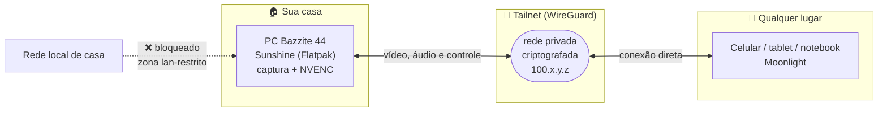

<div align="center">

# 🎮 Jogue o PC de casa, de qualquer lugar

**Streaming de jogos do seu PC Linux para celular, tablet ou notebook — sem abrir nenhuma porta no roteador.**

[](https://bazzite.gg)
[](https://docs.lizardbyte.dev/projects/sunshine/)
[](https://tailscale.com)
[](https://moonlight-stream.org)

**Português** · [English](README.en.md)

[Guia completo (HTML)](guias/bazzite-host-tailscale-sunshine.html) ·
[Vídeo-tutorial](video/render/) ·
[Host Windows](planos/configurar-tailscale-sunshine-moonlight.md)

</div>

---

## 🤖 Deixe um agente de IA configurar para você

Este repositório traz um [`AGENTS.md`](AGENTS.md) — lido automaticamente por **Claude Code**,
**Codex**, **Cursor** e outros agentes. Ele contém o procedimento executável, com verificação a
cada passo e as travas de segurança.

```bash
git clone https://github.com/edilsonvilarinho/configurar-tailscale-sunshine-moonlight.git
cd configurar-tailscale-sunshine-moonlight
claude          # ou: codex, cursor-agent, opencode...
```

E peça, com estas palavras ou parecidas:

```text
Leia o AGENTS.md e configure este host seguindo o procedimento,
verificando cada passo antes de seguir para o próximo.
```

<details>
<summary><b>O que o agente faz — e o que ele não faz sem você</b></summary>

**Faz sozinho:** inventário da máquina, instalação do Sunshine, ajuste do `sunshine.conf` (com
backup), escolha do monitor, verificação de portas e serviços, e o relatório final.

**Pede você:** a senha do `sudo` (ele não consegue digitá-la — ou te entrega o comando, ou abre um
terminal na sua sessão), a aprovação do login da Tailscale no navegador, a criação da senha do
Sunshine, e o PIN do Moonlight.

**Não faz sem sua confirmação explícita:** ligar login automático, mascarar a suspensão do
sistema, e restringir o firewall da rede local.

**Nunca faz:** abrir porta no roteador, desativar o firewall, habilitar UPnP, ou gravar senha,
token e PIN em arquivo, log ou commit.
</details>

> [!TIP]
> Prefere fazer à mão? O passo a passo completo está logo abaixo — o `AGENTS.md` é só o mesmo
> procedimento escrito para ser executado por máquina.

---

## O que é isto

Um guia testado de ponta a ponta para transformar um PC com **Bazzite 44** em servidor de jogos
remoto. O PC fica em casa; você joga de onde estiver, pela rede privada da Tailscale.

**Nada é exposto na internet:** sem port forwarding, sem UPnP, sem IP público. O serviço só é
alcançável por dispositivos autenticados na sua tailnet.

### Resultado medido

Números reais da instalação que originou este guia, não estimativa:

| | |
|---|---|
| Vídeo | **HEVC** por **NVENC** (RTX 4070 SUPER), 3440×1440 |
| Taxa | 15 Mbps, cadência de 60 fps |
| Áudio | Opus 48 kHz, 2 canais |
| Conexão | **direta** entre cliente e host (sem relay DERP) |
| Portas abertas na internet | **nenhuma** |

---

## Como funciona



| Peça | Onde roda | Função |
|---|---|---|
| **Sunshine** | no PC com os jogos | captura a tela, codifica na GPU e transmite |
| **Moonlight** | no aparelho que recebe | decodifica e devolve teclado, mouse e controle |
| **Tailscale** | nos dois | rede privada WireGuard que liga os dois diretamente |

---

## Antes de começar

- Um PC com **Bazzite** (testado na versão 44 Kinoite, imagem `bazzite-nvidia-open`)
- Sessão **Wayland + KDE** (padrão do Kinoite)
- Conta gratuita na [Tailscale](https://tailscale.com)
- Um aparelho para receber: celular, tablet ou outro computador

> [!NOTE]
> Nos comandos abaixo, `100.x.y.z` é o endereço que **o seu** host vai receber na tailnet.
> Descubra o seu com `tailscale ip -4` e use esse valor.

---

## Começo rápido

Para quem já conhece o terreno. O passo a passo detalhado vem logo depois.

```bash
# 1. conferir a máquina (não altera nada)
bash scripts/bazzite-host-preflight.sh

# 2. Tailscale (já vem na imagem do Bazzite)
ujust tailscale enable
sudo tailscale up --operator=$USER
tailscale ip -4

# 3. Sunshine
ujust setup-sunshine          # escolher: Enable (Flatpak)

# 4. liberar a interface web pela tailnet
CONF=~/.var/app/dev.lizardbyte.app.Sunshine/config/sunshine/sunshine.conf
cp -a "$CONF" "$CONF.backup-$(date +%Y%m%d-%H%M%S)"
printf 'origin_web_ui_allowed = wan\nupnp = disabled\n' >> "$CONF"
printf 'csrf_allowed_origins = https://%s:47990\n' "$(tailscale ip -4)" >> "$CONF"
systemctl --user restart app-dev.lizardbyte.app.Sunshine

# 5. fechar as portas para a rede local (ver por que no passo 6)
bash scripts/bazzite-host-firewall-tailnet.sh --apply
```

---

## Passo a passo

### Passo 0 · Olhar antes de tocar

Nenhum destes comandos altera o sistema. Guarde a saída: é com ela que você compara se algo
der errado adiante.

```bash
bash scripts/bazzite-host-preflight.sh
```

<details>
<summary>O que o script verifica (clique para abrir)</summary>

```bash
grep -E '^(PRETTY_NAME|VARIANT_ID)=' /etc/os-release   # versão e variante do Bazzite
echo $XDG_SESSION_TYPE $XDG_CURRENT_DESKTOP            # precisa ser: wayland KDE
nvidia-smi --query-gpu=name,driver_version --format=csv,noheader
systemctl is-enabled tailscaled                        # estado da Tailscale
flatpak info dev.lizardbyte.app.Sunshine               # Sunshine já instalado?
firewall-cmd --get-default-zone                        # zona padrão do firewalld
firewall-cmd --get-active-zones
```
</details>

---

### Passo 1 · Ligar a Tailscale

O binário **já vem na imagem do Bazzite** — só está desligado.

```bash
ujust tailscale enable
# equivale a: sudo systemctl enable --now tailscaled.service
# pela interface: Bazzite Portal → Manage Bazzite → Enable Tailscale

sudo tailscale up --operator=$USER
```

O comando imprime um link `https://login.tailscale.com/a/…`. Abra no navegador e aprove o
computador **na mesma conta** que o aparelho cliente vai usar.

```bash
tailscale status      # confirma a tailnet
tailscale ip -4       # ANOTE: é por este endereço que o cliente chega
tailscale netcheck    # diagnóstico de rota, se precisar
```

> [!TIP]
> O `--operator=$USER` permite rodar `tailscale status` e `tailscale ip` depois sem `sudo`.

---

### Passo 2 · Instalar o Sunshine

```bash
ujust setup-sunshine        # escolher: Enable (Flatpak)
```

<details>
<summary>O que a receita executa por baixo</summary>

```bash
flatpak install --system -y dev.lizardbyte.app.Sunshine
flatpak run --command=additional-install.sh dev.lizardbyte.app.Sunshine   # pede senha
systemctl --user enable --now app-dev.lizardbyte.app.Sunshine
```

O `additional-install.sh` instala as permissões de `uinput`. **Sem ele há imagem, mas não há
teclado, mouse nem controle remotos.**
</details>

Confirme que subiu:

```bash
systemctl --user status app-dev.lizardbyte.app.Sunshine --no-pager
ss -ltn | grep -E ':(47984|47989|47990|48010) '
```

> [!IMPORTANT]
> O Flatpak **não** suporta captura KMS, necessária para transmitir o Game Mode (gamescope) das
> imagens Deck. Em desktop Kinoite, o Flatpak é o caminho certo; para Game Mode, veja
> `ujust setup-sunshine enable-brew`.

---

### Passo 3 · Permissão de captura (Wayland/KDE)

Este passo não existe no Windows e é onde mais gente trava.

1. Na primeira captura, o KDE pede autorização — **aceite e marque para lembrar**.
2. Em *Configurações do Sistema → Aplicativos → Permissões*, ligue **Controle remoto** para o Sunshine.
3. Na interface do Sunshine, use captura **KWin Screencast**.

**Erro 503 / "Failed to find display":**

```bash
mkdir -p ~/.config/environment.d
echo 'KWIN_WAYLAND_NO_PERMISSION_CHECKS=1' > ~/.config/environment.d/98-kwin-no-permission-checks.conf
# saia da sessão e entre de novo — a variável só vale em sessão nova
```

> [!WARNING]
> **X11 e NvFBC não funcionam no Bazzite.** Não perca tempo com eles.

---

### Passo 4 · Criar a senha do Sunshine

Faça o primeiro acesso **localmente**:

```bash
xdg-open https://localhost:47990      # ou: ujust setup-sunshine portal
```

O aviso de certificado é esperado (autoassinado). Crie o usuário e uma **senha forte** — essa
senha protege o controle total do seu computador; não reutilize a senha do sistema.

<details>
<summary>Redefinir a senha pela linha de comando</summary>

```bash
systemctl --user stop app-dev.lizardbyte.app.Sunshine
flatpak run --command=sunshine dev.lizardbyte.app.Sunshine --creds admin 'SUA-SENHA-FORTE'
systemctl --user start app-dev.lizardbyte.app.Sunshine
```
</details>

---

### Passo 5 · Liberar a interface web pela tailnet

Duas pegadinhas do Sunshine, as duas no mesmo arquivo:

- **`origin_web_ui_allowed`** — o padrão `lan` aceita só faixas privadas. A tailnet usa
  `100.64.0.0/10` (CGNAT), que **não** conta como LAN. Precisa de `wan`.
- **`csrf_allowed_origins`** — sem a origem exata, o envio do PIN falha com `CSRF Protection Error`.

```bash
CONF=~/.var/app/dev.lizardbyte.app.Sunshine/config/sunshine/sunshine.conf
cp -a "$CONF" "$CONF.backup-$(date +%Y%m%d-%H%M%S)"

HOST_IP=$(tailscale ip -4)
printf 'origin_web_ui_allowed = wan\nupnp = disabled\n' >> "$CONF"
printf 'csrf_allowed_origins = https://%s:47990\n' "$HOST_IP" >> "$CONF"

systemctl --user restart app-dev.lizardbyte.app.Sunshine
grep -E 'origin_web_ui_allowed|csrf_allowed_origins|upnp' "$CONF"
```

> [!NOTE]
> `wan` **não** publica nada na internet: apenas desliga o filtro por faixa de IP. Quem limita o
> alcance é o firewall (passo 6) somado à ausência de port forwarding. `upnp = disabled` impede o
> roteador de abrir portas por conta própria.

---

### Passo 6 · Firewall — e a surpresa do Linux

Aqui o Linux **inverte** em relação ao Windows. A zona padrão do Bazzite (`FedoraWorkstation`) contém:

```xml
<port protocol="tcp" port="1025-65535"/>
<port protocol="udp" port="1025-65535"/>
```

Todas as portas do Sunshine **já nascem abertas, em todas as interfaces** — inclusive na sua rede
de casa. Não falta abrir nada: falta **fechar**.

| | Windows | Bazzite |
|---|---|---|
| Comportamento padrão | bloqueia | libera a faixa alta inteira |
| Seu trabalho | abrir as portas certas | fechar o que não deve ficar aberto |
| Sintoma de erro | não conecta de jeito nenhum | conecta até demais, da LAN também |

```bash
bash scripts/bazzite-host-firewall-tailnet.sh            # simula (padrão)
bash scripts/bazzite-host-firewall-tailnet.sh --apply    # aplica
bash scripts/bazzite-host-firewall-tailnet.sh --revert   # desfaz
```

<details>
<summary>À mão, e por que funciona</summary>

A interface da tailnet fica na zona padrão (permissiva), e a placa de casa vai para uma zona nova:

```bash
ZONE=lan-restrito
sudo firewall-cmd --permanent --new-zone="$ZONE"
sudo firewall-cmd --permanent --zone="$ZONE" --add-service=dhcpv6-client
sudo firewall-cmd --permanent --zone="$ZONE" --add-service=mdns
sudo firewall-cmd --reload

# prende a zona na conexão, para sobreviver a reboot
sudo nmcli connection modify "Conexão cabeada 1" connection.zone "$ZONE"
sudo nmcli connection up "Conexão cabeada 1"

firewall-cmd --get-active-zones
firewall-cmd --get-zone-of-interface=tailscale0    # esperado: no zone
```

Conferindo de fora:

```bash
nc -vz <ip-da-lan>   47990    # deve FALHAR
nc -vz <ip-100.x.y.z> 47990   # deve CONECTAR
```

A zona restrita bloqueia entrada da LAN nas portas altas: KDE Connect, Steam Remote Play local e
compartilhamentos param. Libere a porta específica em vez de desistir da restrição — o script
aceita `EXTRA_PORTS="1714-1764/tcp 1714-1764/udp"`.
</details>

> [!CAUTION]
> **Não troque a zona da interface `tailscale0`.** Há um defeito conhecido
> ([tailscale#15968](https://github.com/tailscale/tailscale/issues/15968), versões ≥ 1.84) em que
> isso derruba a interface. A estratégia acima nunca a toca.

---

### Passo 7 · Escolher o monitor certo

Com mais de um monitor, o erro aqui é **silencioso**: sem configurar, o Sunshine captura o
primeiro fluxo disponível, que pode não ser a sua tela principal. Nada falha — só chega a tela
errada no cliente.

```bash
# descubra o nome no log do próprio Sunshine
grep '\[wayland\] Name' ~/.var/app/dev.lizardbyte.app.Sunshine/config/sunshine/sunshine.log | tail -4

echo 'output_name = DP-1' >> "$CONF"
systemctl --user restart app-dev.lizardbyte.app.Sunshine

grep 'Streaming display' ~/.var/app/dev.lizardbyte.app.Sunshine/config/sunshine/sunshine.log | tail -1
# esperado: [pipewire] Streaming display 'DP-1' resolution: 3440x1440
```

<details>
<summary>Sem monitor físico (monitor virtual)</summary>

```bash
ujust setup-sunshine virtual-monitor     # → Add Virtual Monitor
```
Só funciona no KWin (Kinoite) e exige captura **KWin Screencast**.
</details>

---

### Passo 8 · O PC pronto mesmo sem ninguém na frente

No Bazzite o Sunshine é um **serviço de usuário** e a captura depende da sessão gráfica aberta.
Se o PC reiniciar e ninguém logar, não há tela para capturar.

```bash
# 1. login automático no KDE
sudo mkdir -p /etc/sddm.conf.d
sudo tee /etc/sddm.conf.d/10-autologin.conf >/dev/null <<'EOF'
[Autologin]
User=SEU-USUARIO
Session=plasma.desktop
Relogin=false
EOF

# 2. não suspender (senão você perde o acesso remoto)
sudo systemctl mask sleep.target suspend.target hibernate.target hybrid-sleep.target

# 3. manter o serviço do usuário vivo entre sessões
loginctl enable-linger $USER
```

> [!WARNING]
> Login automático é uma troca consciente: quem tiver acesso **físico** à máquina entra no seu
> desktop sem senha. Para desfazer: `sudo rm /etc/sddm.conf.d/10-autologin.conf` e
> `sudo systemctl unmask sleep.target suspend.target hibernate.target hybrid-sleep.target`.

---

### Passo 9 · O aparelho cliente

1. Instale a **Tailscale** e entre na **mesma conta** do PC.
2. Instale o **Moonlight**:
   - Android / iOS: loja do aparelho
   - Linux: `flatpak install flathub com.moonlight_stream.Moonlight`
   - Windows: `winget install MoonlightGameStreamingProject.Moonlight`
3. No Moonlight: **Add PC** → digite o endereço `100.x.y.z` do host.
4. O Moonlight mostra um **PIN de 4 dígitos**.

Envie o PIN pela interface web (`https://100.x.y.z:47990`, aba **PIN**) ou, mais direto, pela API
do próprio host:

```bash
curl -sk -u admin:'SUA-SENHA' -X POST https://localhost:47990/api/pin \
  -d '{"pin":"1234","name":"celular"}'
# resposta esperada: {"status":"true"}
```

> [!TIP]
> O atalho pela API evita o erro de CSRF, porque não passa pelo navegador.

---

## Portas usadas

Nenhuma precisa ser aberta no roteador. A tabela serve para diagnóstico.

| Porta | Protocolo | Uso |
|---|---|---|
| 47984 | TCP | HTTPS do serviço |
| 47989 | TCP | HTTP do serviço (porta base) |
| 47990 | TCP | interface web |
| 48010 | TCP | RTSP |
| 47998 / 47999 / 48000 | UDP | vídeo / controle / áudio |
| 48002 | UDP | microfone (opcional) |

---

## Validação final

```bash
tailscale status                                            # tailnet certa, IP 100.x.y.z
systemctl --user is-active app-dev.lizardbyte.app.Sunshine  # active
ss -ltn | grep -E ':(47984|47989|47990|48010) '             # 4 portas escutando
curl -sk -o /dev/null -w '%{http_code}\n' https://$(tailscale ip -4):47990/   # 401 = ok
curl -sk -u admin:SENHA https://localhost:47990/api/apps | jq -r '.apps[].name'
```

- [ ] Da LAN (fora da tailnet), a porta 47990 **não** conecta
- [ ] Moonlight lista as aplicações e inicia a sessão
- [ ] Imagem, áudio, teclado, mouse e controle funcionam
- [ ] Depois de um reboot, tudo volta sozinho

---

## Diagnóstico

| Sintoma | Causa provável | Solução |
|---|---|---|
| Interface web não abre nem em `localhost` | serviço parado ou sem sessão gráfica | `journalctl --user -u app-dev.lizardbyte.app.Sunshine -b` |
| Abre local, não abre pela tailnet | `origin_web_ui_allowed = lan` | passo 5 |
| `CSRF Protection Error` ao enviar o PIN | origem não autorizada | `csrf_allowed_origins` com o endereço exato |
| Erro 503 / "Failed to find display" | KWin recusou a captura | `KWIN_WAYLAND_NO_PERMISSION_CHECKS=1` + relogin |
| Vídeo funciona, mouse e teclado não | `additional-install.sh` não rodou | `flatpak run --command=additional-install.sh dev.lizardbyte.app.Sunshine` |
| Chegou a tela errada | `output_name` não definido | passo 7 |
| `tailscale ping` falha | rota/tailnet, não é firewall | `tailscale netcheck` nos dois lados |
| Ping ok, porta fechada | firewall ou serviço parado | `firewall-cmd --list-all --zone=lan-restrito` |
| `Failed to gain CAP_SYS_ADMIN` no log | **ruído** — sonda de captura KMS no Flatpak | ignore; o próprio log avisa |

<details>
<summary>Coleta de evidências</summary>

```bash
journalctl --user -u app-dev.lizardbyte.app.Sunshine -b --no-pager | tail -200
sudo nft list ruleset | head -80
firewall-cmd --list-all-zones
tailscale status --json | head -40
sudo tcpdump -ni tailscale0 'port 47990 or port 48010' -c 20
```

Nunca cole senha, token ou PIN em log, issue ou pull request.
</details>

---

## Estrutura do repositório

```
.
├── AGENTS.md                                  procedimento executável para agentes de IA
├── guias/
│   └── bazzite-host-tailscale-sunshine.html   guia visual completo, passo a passo
├── scripts/
│   ├── bazzite-host-preflight.sh              pré-validação (somente leitura)
│   └── bazzite-host-firewall-tailnet.sh       restringe o Sunshine à tailnet
├── planos/
│   ├── configurar-bazzite-sunshine-tailscale-moonlight.md   decisões e execução (Linux)
│   ├── configurar-tailscale-sunshine-moonlight.md           host Windows
│   ├── guia-maquina-cliente-tailscale-moonlight.md          cliente Windows
│   └── *.ps1                                                scripts do host Windows
└── video/
    ├── roteiro.py           roteiro do vídeo (fonte única de verdade)
    ├── gerar_video.py       renderizador: PIL + Piper + ffmpeg
    ├── gerar_miniatura.py   miniatura do YouTube
    ├── publicacao.md        títulos, descrições e hashtags por plataforma
    └── render/              vídeos prontos (6 formatos) + legendas + miniatura
```

---

## Vídeo-tutorial

Gerado por código — roteiro em arquivo de dados, narração sintetizada, telas desenhadas. Para
corrigir um comando, edita-se o roteiro e renderiza de novo. Detalhes em
[`video/README.md`](video/README.md).

| Corte | Formato | Duração | Arquivo |
|---|---|---|---|
| YouTube (completo) | 1920×1080 | 8min21 | [`youtube-longo.mp4`](video/render/youtube-longo.mp4) |
| YouTube Shorts | 1080×1920 | 1min00 | [`youtube-shorts.mp4`](video/render/youtube-shorts.mp4) |
| TikTok | 1080×1920 | 1min01 | [`tiktok.mp4`](video/render/tiktok.mp4) |
| Instagram Reels | 1080×1920 | 1min03 | [`instagram-reels.mp4`](video/render/instagram-reels.mp4) |
| Instagram feed | 1080×1350 | 1min03 | [`instagram-feed.mp4`](video/render/instagram-feed.mp4) |
| LinkedIn | 1080×1080 | 1min38 | [`linkedin.mp4`](video/render/linkedin.mp4) |

---

## Host Windows

A configuração equivalente no Windows, com o registro de execução e os scripts PowerShell, está em
[`planos/configurar-tailscale-sunshine-moonlight.md`](planos/configurar-tailscale-sunshine-moonlight.md).
O cliente Windows tem guia próprio em
[`planos/guia-maquina-cliente-tailscale-moonlight.md`](planos/guia-maquina-cliente-tailscale-moonlight.md).

A diferença central entre os dois sistemas está no firewall: no Windows o perfil `Private` com
`AllowInboundRules=False` engolia as regras do Sunshine; no Bazzite, a zona padrão libera demais.

---

## Segurança

- Nenhuma porta é aberta no roteador, e `upnp` fica desabilitado.
- A interface web exige autenticação e só é alcançável pela tailnet.
- O pareamento é por PIN, por dispositivo, e não se herda entre instalações.
- **Senha, token e PIN nunca entram neste repositório** — nem em log, issue ou pull request.
- Ampliar o acesso dentro da tailnet é decisão explícita, pelas ACLs da Tailscale.

---

## Créditos

[Bazzite](https://bazzite.gg) · [Sunshine](https://github.com/LizardByte/Sunshine) ·
[Moonlight](https://github.com/moonlight-stream) · [Tailscale](https://tailscale.com)
